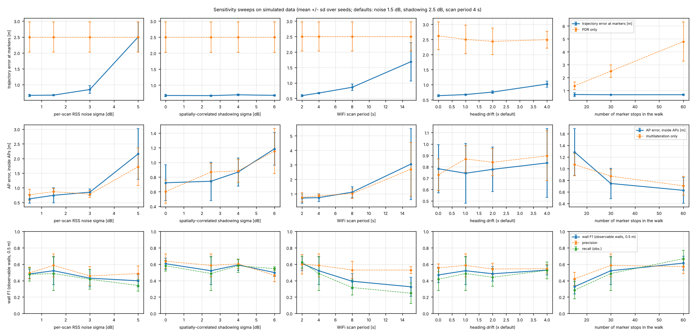
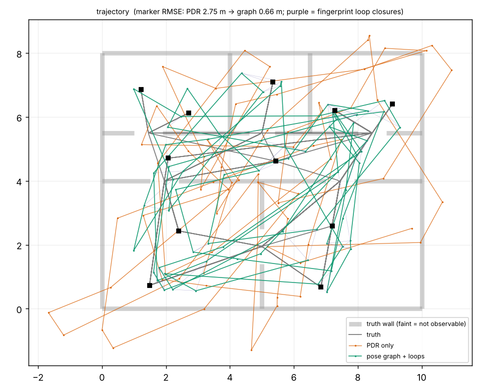
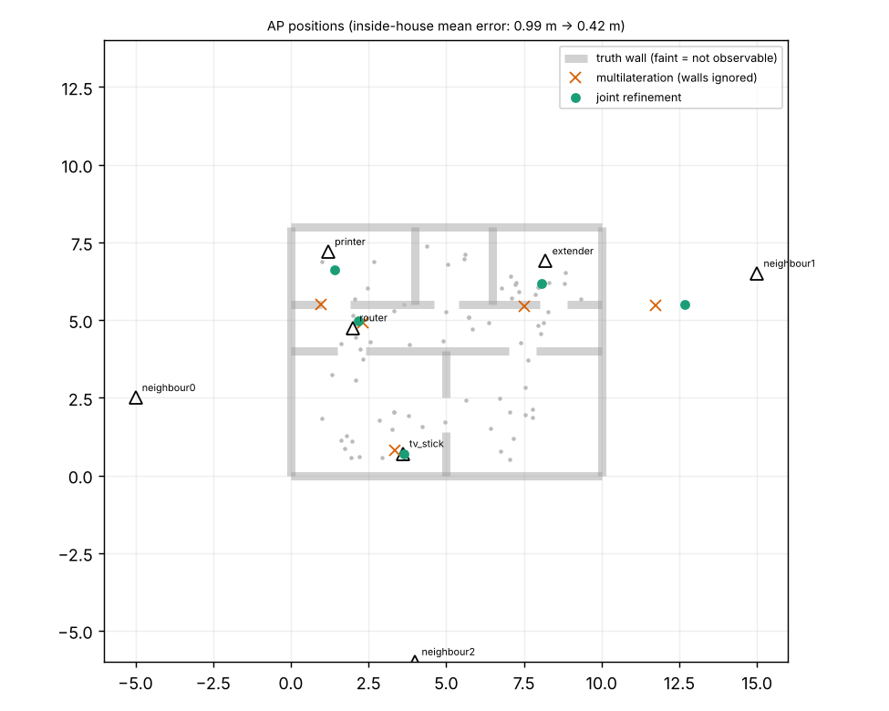
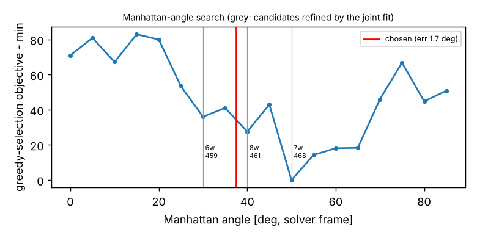
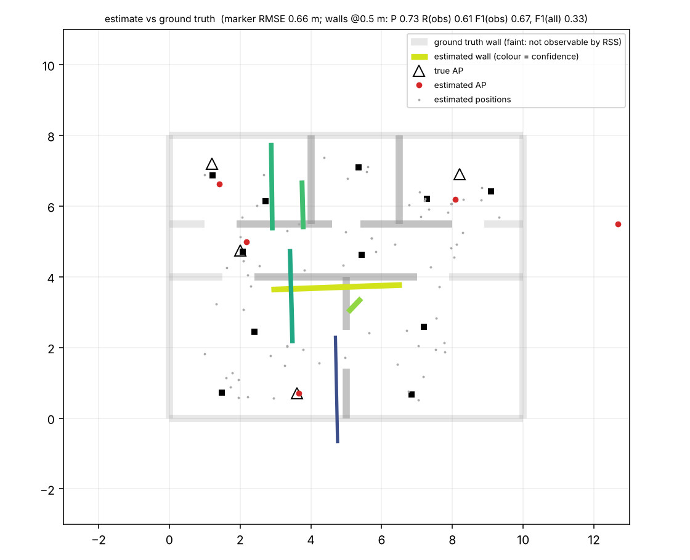

# wallmap

**Infer a building's walls from the WiFi scans, IMU and (optionally) WiFi RTT ranges of a phone you carry around it.**

Walk through a flat with an Android phone logging WiFi scans, accelerometer/gyro/rotation vector, barometer and
waypoint button presses. Offline, a laptop pipeline estimates

1. the **walking trajectory** (dead reckoning + WiFi-fingerprint loop closure),
2. the **positions of the access points** (unknown; BSSIDs are first clustered into physical boxes),
3. a **2D wall layout** with per-wall confidence, by fitting a differentiable propagation model (JAX) with a
   Manhattan-world prior.

> **Research prototype.** Output is a *plausible, coarse* floor plan with confidence, not a survey. With 20-80 MHz
> WiFi, RSS-only wall fitting is ambiguous (see [what works / what doesn't](#what-works-and-what-doesnt)).
> Everything below was validated on **simulated** data only; nothing here has been run on a real building or a
> real phone yet. See [Status](#status) and [Next manual steps](#next-manual-steps-for-you).


## Quickstart

```bash
uv sync                                   # Python 3.11+, numpy/scipy/matplotlib/JAX(CPU)/pyyaml
make test                                 # Python tests (~1 min)
make sim                                  # simulate a walk -> data/sim_seed1/  (+ eval/out/sim_seed1_truth.png)
make solve                                # full pipeline + evaluation -> eval/out/sim_seed1/
make sweep                                # noise / sampling-rate sweeps (about 10 minutes)

# real data (after a walk, see docs/survey-guide.md)
uv run solver run --session data/home_walk_1 --truth ground_truth.yaml --step-length 0.70
uv run python -m eval.overlay --result eval/out/home_walk_1/result.json --truth ground_truth.yaml

# Android logger
cd android && ./gradlew assembleDebug && ./gradlew testDebugUnitTest      # see android/README.md
```

`solver run` writes to `eval/out/<session>/`: `walls.geojson`, `walls.svg` (per-wall confidence as opacity/width),
`result.json` (everything in the solver frame), and the intermediate-result plots `trajectory.png`, `aps.png`,
`walls.png`, `theta_scan.png`. `--truth` is optional; without it you just don't get metrics or aligned plots.
`--labelled` is the ablation that feeds waypoint markers to the pose graph.

## Repository layout

```
docs/    data-format.md  survey-guide.md  ground-truth.md  design.md  img/
sim/     floor plans, APs (mesh extender, LA-bit BSSIDs), waypoint walks, IMU + RSS + RTT models, fake_real converter
solver/  pdr  grouping  posegraph  aploc  atlas/omp (wall candidates)  wallfit (JAX)  pipeline  export  cli
eval/    metrics  evaluate  plots  overlay  sweep  (ground_truth.example.yaml)
common/  session IO, anonymiser, geometry (shared by sim/solver/eval)
android/ Kotlin + Compose logger (Gradle project)
tests/   pytest suite (sim determinism, PDR, grouping, pose graph, wall estimation, M4 replay)
data/    gitignored: real sessions go here
```

## How it works (short version; details in [docs/design.md](docs/design.md))

| stage | what | notes |
|---|---|---|
| 1 PDR | step detection on low-passed \|acc\|, heading from rotation vector / gyro / complementary fusion | reports drift |
| 2 BSSID grouping | MAC closeness (LA bit cleared) *and* RSSI-trace agreement, complete linkage | a mesh extender with MACs next to the router's stays separate |
| 3 pose graph | (x, y, theta) per scan + odometry scale; PDR odometry + fingerprint loop closures; `scipy.optimize.least_squares` | GTSAM not used (not needed for a 2D graph of ~100 nodes) |
| 4 AP localisation | log-distance (+RTT) multilateration, per-BSSID offsets, path-loss exponent | initial guess only |
| 5 wall fitting | Manhattan angle search + greedy wall selection on an axis-aligned lattice, then joint differentiable fit (walls, APs, offsets, exponent; soft crossing counts annealed in temperature), leave-one-out pruning, bootstrap ensemble for confidence | RSS + RTT excess delay + priors |
| 6 export | GeoJSON, SVG, `result.json`, plots | |

## Results (simulated data only)

All numbers are on the **simulated 10 x 8 m flat** (router with 3 BSSIDs, mesh extender with adjacent MACs, TV stick, printer,
3 neighbours outside), default noise (1.5 dB per scan, 2.5 dB correlated shadowing, scan every ~4 s, ~5 min walk, 30 stops),
**8 held-out seeds (101-108, not used for any tuning)**, mean +/- sd. Wall metrics: tolerance 0.5 m, "obs" = over the walls RSS can in
principle see (about 30-38 % of the wall length here; see below), "all" = over every true wall incl. the outer shell.

| quantity | result |
|---|---|
| PDR-only error at markers (rigid-aligned) | 3.33 +/- 0.57 m (drift about 3 % of path) |
| after pose graph + fingerprint loop closure | **0.63 +/- 0.05 m** (ATE over all scans 0.61 m) |
| BSSID grouping | all physical APs recovered exactly, extender kept separate from the router |
| AP position error, APs inside the flat | 0.74 +/- 0.41 m (multilateration alone: 0.75 m, so the joint refinement did not help); APs outside: metres |
| walls: precision / recall (obs) / **F1 (obs)** | 0.55 / 0.50 / **0.52 +/- 0.11** |
| walls: F1 (all true walls) | 0.33 +/- 0.08 |
| walls: F1 (obs) at 1.0 m tolerance | 0.79 +/- 0.05 |
| walls: chamfer distance | 1.00 +/- 0.09 m |
| runtime per session (4 cores) | ~15 s (+ ~10 s for the 6-resample confidence ensemble) |

Ablations (same 8 seeds):

| variant | marker error [m] | AP err inside [m] | wall F1 (obs) | comment |
|---|---|---|---|---|
| default | 0.63 | 0.74 | 0.52 | |
| no loop closure (odometry only) | 3.33 | 3.66 | 0.38 | loop closure is what makes everything else work |
| heading from compass only | 0.67 | 1.05 | 0.55 | |
| heading from gyro only | 1.06 | 1.05 | 0.54 | fused (default) has the best trajectory |
| labelled marker revisits (exact closures) | 0.56 | 0.71 | 0.52 | fingerprint closures are almost as good |
| labelled + all marker coordinates as anchors | 0.39 | 0.67 | 0.55 | upper bound for trajectory help |
| 2 simulated ESP32 FTM anchors (RTT) | 0.63 | 0.59 | 0.53 | F1 at 1 m: 0.88 vs 0.79; within noise at n = 8 |
| true Manhattan angle instead of the searched one | - | 0.87 | 0.55 | angle search is not the bottleneck |

Sensitivity sweeps (4 seeds per point, no ensemble; one parameter varied, others at default):



| sweep | value | n ok | marker RMSE [m] | AP err inside [m] | precision | recall (obs) | F1 (obs) | F1 (all) |
|---|---|---|---|---|---|---|---|---|
| rss_noise_db | 0.5 | 4/4 | 0.66 | 0.62 | 0.49 | 0.48 | 0.48 | 0.32 |
| rss_noise_db | 1.5 | 4/4 | 0.67 | 0.74 | 0.59 | 0.49 | 0.52 | 0.34 |
| rss_noise_db | 3.0 | 4/4 | 0.85 | 0.85 | 0.46 | 0.42 | 0.43 | 0.27 |
| rss_noise_db | 5.0 | 4/4 | 2.50 | 2.16 | 0.49 | 0.34 | 0.40 | 0.38 |
| shadow_sigma_db | 0.0 | 4/4 | 0.68 | 0.72 | 0.64 | 0.58 | 0.61 | 0.37 |
| shadow_sigma_db | 2.5 | 4/4 | 0.67 | 0.74 | 0.59 | 0.49 | 0.52 | 0.34 |
| shadow_sigma_db | 4.0 | 4/4 | 0.70 | 0.87 | 0.60 | 0.58 | 0.59 | 0.41 |
| shadow_sigma_db | 6.0 | 4/4 | 0.68 | 1.19 | 0.46 | 0.55 | 0.50 | 0.35 |
| scan_period_s | 2.0 | 4/4 | 0.59 | 0.72 | 0.60 | 0.63 | 0.61 | 0.41 |
| scan_period_s | 4.0 | 4/4 | 0.67 | 0.74 | 0.59 | 0.49 | 0.52 | 0.34 |
| scan_period_s | 8.0 | 4/4 | 0.86 | 1.12 | 0.53 | 0.32 | 0.39 | 0.21 |
| scan_period_s | 15.0 | 4/4 | 1.68 | 3.05 | 0.53 | 0.25 | 0.33 | 0.25 |
| heading_drift_scale | 0.0 | 4/4 | 0.64 | 0.78 | 0.56 | 0.42 | 0.47 | 0.31 |
| heading_drift_scale | 1.0 | 4/4 | 0.67 | 0.74 | 0.59 | 0.49 | 0.52 | 0.34 |
| heading_drift_scale | 2.0 | 4/4 | 0.76 | 0.78 | 0.54 | 0.44 | 0.48 | 0.31 |
| heading_drift_scale | 4.0 | 4/4 | 1.02 | 0.83 | 0.54 | 0.53 | 0.53 | 0.38 |
| n_visits | 15 | 4/4 | 0.69 | 1.28 | 0.42 | 0.28 | 0.33 | 0.19 |
| n_visits | 30 | 4/4 | 0.67 | 0.74 | 0.59 | 0.49 | 0.52 | 0.34 |
| n_visits | 60 | 4/4 | 0.67 | 0.63 | 0.57 | 0.67 | 0.61 | 0.41 |

**Where it breaks:** per-scan RSS noise >= 5 dB (loop closure fails, trajectory 2.5 m), scan period >= 8 s (wall F1 0.39, at 15 s the
trajectory fails too), heading drift at 4x default (trajectory 1.0 m), fewer than ~15 stops (F1 0.33). Shadowing up to 6 dB mostly
hurts AP positions. More stops / faster scans help monotonically (60 stops: F1 0.61), so **sampling rate and walk length are the main
levers** - which is why the survey guide insists on disabling scan throttling.

Intermediate results for one run (`make solve`): trajectory (truth / PDR / pose graph / loop closures), APs, walls, angle search:





Real-session path exercised by the `fake_real` conversion, overlaid on a tape-style `ground_truth.yaml`:




## What works and what doesn't

**Works (in simulation):**
* Trajectory: WiFi-fingerprint loop closure removes most dead-reckoning drift (3.3 -> 0.63 m), nearly as well as exact marker revisits.
* BSSID grouping including LA-bit variants; the router/extender trap (MACs 8 apart) is handled by the RSSI-trace test.
* The strongest structural walls (e.g. the hall wall in the plot above) are found with the right position, and wall F1 at 1 m tolerance is ~0.8.
* The simulated "fake real" session (cached re-deliveries, out-of-order lines, truncated last line) goes through the loaders, `solver run`, the plots and the overlay.

**Does not work / caveats - please read:**
* **RSS cannot see everything.** Every BSSID has a free power offset, so a wall that all rays of an AP cross (e.g. the outer shell seen from
  APs outside) or none does is indistinguishable from it. Only ~30-38 % of the wall length is observable in the test flat, which is why
  F1 over all walls is 0.33 while F1 over observable walls is 0.52. Short stubs (< 1 m) and thin drywall are mostly missed.
* **Individual walls are coarse**: typically 0.5-1 m off, some tilted or in the wrong place (see `walls.png`). Treat the output as a rough sketch.
* **Wall confidence is weak.** Bootstrap support is meant to flag unreliable walls, but its AUROC for "wall is correct" was 0.72 in one
  8-house run and 0.50 in the next (`docs/calibration.md`); the leave-one-out evidence was worse. Do not trust it quantitatively.
* **The Manhattan angle is not identifiable at this data volume** (mean error about 20 deg, close to the 22.5 deg of a random guess), and wall
  accuracy was the same as with the true angle. The orthogonality prior therefore currently neither helps nor hurts.
* **RTT**: the brief's expectation that RTT sharpens results is *not demonstrated*: 2 FTM anchors changed AP error 0.74 -> 0.59 m and F1 0.52 -> 0.53 (n = 8, within noise).
* The joint refinement does not improve AP positions over plain multilateration; APs outside the building are poorly located.
* **Odometry scale is not observable** from loop closures (they bias it low). Step length is a prior (0.70 m, `--step-length`); a 10 % error is a 10 % scale error.
* **Sim-to-real gap.** Simulator and solver share assumptions (log-distance + additive per-wall loss, axis-aligned walls, phone held flat, compass noise as an OU process). Real
  numbers will be worse. Nothing has been run on real data.
* Single floor, 2D, one building at a time.

**Corrections made during development (so you know what the numbers went through):** a bound bug capped every wall at ~4 dB (found by a synthetic-scene test, fixed);
the odometry scale collapsed to 0.4 on long walks (fixed with a tight scale prior; 60-stop error 1.7 -> 0.7 m); the labelled ablation initially
looked worse than fingerprints because of a gauge-prior bug and a marker-to-scan mapping bug (both fixed); one AP with adjacent MACs was not grouped (relaxed rule for MACs <= 2 apart, tested).

## Status

* **Python pipeline, simulator, evaluation:** implemented, tested (`make test`).
* **Android logger:** `./gradlew assembleDebug` and `./gradlew testDebugUnitTest` pass (AGP 8.13.2, Gradle 8.14.3, compile/target SDK 36,
  min SDK 28; 18 JVM unit tests for event serialisation, BSSID logic, the anonymiser (shared test vectors with the Python
  implementation), session store/zip export, scan statistics, JSONL writer). The Android framework glue (sensors,
  WifiManager scan loop, RTT ranging, foreground service, Compose UI) **compiles but has never been run on a device** - no phone
  was available. Treat the first walk as its acceptance test; the list of things to verify is in
  [android/README.md](android/README.md#untested-on-hardware-please-check-on-the-first-walk).
* **Real data:** none yet. The `fake_real` conversion (a simulator run turned into what the app would write, with
  cached re-deliveries, out-of-order lines, a truncated last line, uptime clock offset, and a tape-style
  `ground_truth.yaml`) exercises the real loaders and `solver run`, and is part of the test suite.

## Next manual steps for you

1. **Build and install the APK** (needs the Android SDK, e.g. Android Studio):
   `cd android && ./gradlew assembleDebug && adb install -r app/build/outputs/apk/debug/app-debug.apk`
   (details and the Maven-mirror note in [android/README.md](android/README.md)).
2. **Phone setup** ([docs/survey-guide.md](docs/survey-guide.md) step 0): enable Developer options, switch **Wi-Fi scan throttling
   off**, grant the app location + Nearby devices, set battery to Unrestricted, tick your own APs in *My APs*.
3. **Prepare the flat**: stick 8-15 numbered markers on the floor (some in doorways), tape-measure wall endpoints, marker
   positions and your APs' positions from one corner, write them into `ground_truth.yaml`
   ([docs/ground-truth.md](docs/ground-truth.md), example: `eval/ground_truth.example.yaml`). Note your APs' BSSIDs.
4. **First walk** (5-10 min, phone flat in front of you, 4-5 s pause at every marker, press the marker button on arrival, several
   loops and revisits, end where you started). Check `meta.json`: `scan.median_period_s` should be well below 20 s,
   `sensors.acc.achieved_hz` about 50.
5. **Export** from the app (*Anonymise* if you will share it), copy the zip to the laptop, unzip into `data/home_walk_1/`, then
   `uv run python -m solver.cli run --session data/home_walk_1 --truth ground_truth.yaml` and look at
   `eval/out/home_walk_1/*.png`. If something looks off, `result.json` plus the plots are the first things to send me.
6. Repeat with `--labelled` to see how much exact marker revisits would help, and with a second walk on another day (different
   RSSI conditions) to check repeatability.

## Prioritised next steps (engineering)

1. **Real-data shake-down** (above). Expect surprises: heading from a hand-held phone, RSSI offsets between phones/bands,
   many weak neighbour APs, Samsung scan behaviour. The simulator shares the solver's assumptions, so it is an upper bound.
2. **RTT tuning**: only worthwhile once you have responders. Fit per-AP NLOS bias and a mixture for outliers instead of a single
   pseudo-Huber; use `distance_std_mm`/success ratio as weights; log `rssi` per range to gate. In simulation 2 FTM anchors
   gave a modest, not statistically convincing gain (see results), so do not expect miracles from a router that happens to support 11mc.
3. **A controllable ESP32 FTM responder as ground-truth anchor** (2-3 boards at known positions): absolute range
   constraints break the offset/exponent ambiguity that limits RSS-only fits and pin the frame without markers. Also the cheapest way
   to measure real NLOS excess delay through your own walls.
4. **Joint trajectory + wall refinement**: node positions are currently fixed after the pose graph; letting the wall likelihood
   move them (and AP-position-aware loop closures) should remove the residual 0.7 m error.
5. **Multi-floor with the barometer**: segment floors by pressure steps (the `baro` stream is already logged), fit per floor
   with inter-floor attenuation as a separate slab term, stair detection from PDR.
6. **Campus-scale run (KCL)**: tile the problem (rooms/corridors), many more APs and eduroam-style multi-BSSID groups, outdoor/GPS
   anchoring (GPS fixes are logged), non-Manhattan walls, runtime (the dense ray x wall tensor is O(rays x walls)).
7. **Per-band wall loss and frequency-dependent exponents**, per-AP exponents, shadowing as a Gaussian process instead of a robust loss.
8. **Better confidence**: calibrate bootstrap support against held-out walls; add Laplace/Hessian estimates around the optimum.

## Privacy

Only AP metadata is logged: no packet capture, no payloads, no other devices' traffic. Export with *Anonymise*
(Android) or `common/anonymize.py` replaces BSSIDs/SSIDs not marked as yours by salted pseudonyms that keep what AP
grouping needs (see [docs/data-format.md](docs/data-format.md#privacy)). `data/` and `*.jsonl` are git-ignored.
