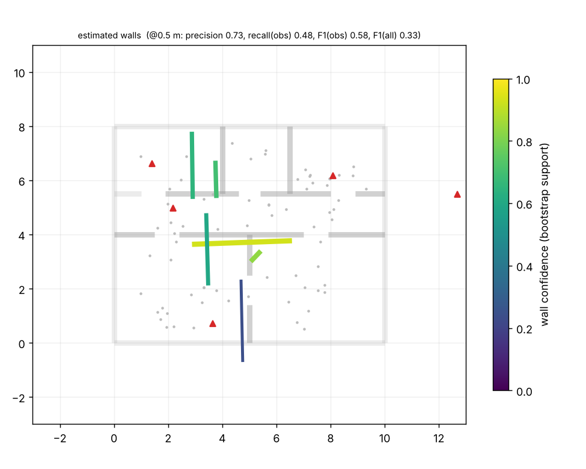

# wallmap

**Infer a building's walls from the WiFi scans, IMU and (optionally) WiFi RTT ranges of a phone you carry around it.**

Walk through a flat with an Android phone logging WiFi scans, accelerometer/gyro/rotation vector, barometer and
waypoint button presses. Offline, a laptop pipeline estimates

1. the **walking trajectory** (dead reckoning + WiFi-fingerprint loop closure),
2. the **positions of the access points** (unknown; BSSIDs are first clustered into physical boxes),
3. a **2D wall layout** with per-wall confidence, by fitting a differentiable propagation model (JAX) with a
   Manhattan-world prior.

> **Research prototype.** Output is a *plausible, coarse* floor plan with confidence, not a survey. With 20-80 MHz
> WiFi, RSS-only wall fitting is ambiguous (see [what works / what doesn't](#what-works-and-what-doesnt)).
> Everything below was validated on **simulated** data only; nothing here has been run on a real building or a
> real phone yet. See [Status](#status) and [Next manual steps](#next-manual-steps-for-you).



## Quickstart

```bash
uv sync                                   # Python 3.11+, numpy/scipy/matplotlib/JAX(CPU)/pyyaml
make test                                 # Python tests (~1 min)
make sim                                  # simulate a walk -> data/sim_seed1/  (+ eval/out/sim_seed1_truth.png)
make solve                                # full pipeline + evaluation -> eval/out/sim_seed1/
make sweep                                # noise / sampling-rate sweeps (about 10 minutes)

# real data (after a walk, see docs/survey-guide.md)
uv run python -m solver.cli run --session data/home_walk_1 --truth ground_truth.yaml
uv run python -m eval.overlay --result eval/out/home_walk_1/result.json --truth ground_truth.yaml

# Android logger
cd android && ./gradlew assembleDebug && ./gradlew testDebugUnitTest      # see android/README.md
```

`solver run` writes to `eval/out/<session>/`: `walls.geojson`, `walls.svg` (per-wall confidence as opacity/width),
`result.json` (everything in the solver frame), and the intermediate-result plots `trajectory.png`, `aps.png`,
`walls.png`, `theta_scan.png`. `--truth` is optional; without it you just don't get metrics or aligned plots.
`--labelled` is the ablation that feeds waypoint markers to the pose graph.

## Repository layout

```
docs/    data-format.md  survey-guide.md  ground-truth.md  design.md  img/
sim/     floor plans, APs (mesh extender, LA-bit BSSIDs), waypoint walks, IMU + RSS + RTT models, fake_real converter
solver/  pdr  grouping  posegraph  aploc  atlas/omp (wall candidates)  wallfit (JAX)  pipeline  export  cli
eval/    metrics  evaluate  plots  overlay  sweep  (ground_truth.example.yaml)
common/  session IO, anonymiser, geometry (shared by sim/solver/eval)
android/ Kotlin + Compose logger (Gradle project)
tests/   pytest suite (sim determinism, PDR, grouping, pose graph, wall estimation, M4 replay)
data/    gitignored: real sessions go here
```

## How it works (short version; details in [docs/design.md](docs/design.md))

| stage | what | notes |
|---|---|---|
| 1 PDR | step detection on low-passed \|acc\|, heading from rotation vector / gyro / complementary fusion | reports drift |
| 2 BSSID grouping | MAC closeness (LA bit cleared) *and* RSSI-trace agreement, complete linkage | a mesh extender with MACs next to the router's stays separate |
| 3 pose graph | (x, y, theta) per scan + odometry scale; PDR odometry + fingerprint loop closures; `scipy.optimize.least_squares` | GTSAM not used (not needed for a 2D graph of ~100 nodes) |
| 4 AP localisation | log-distance (+RTT) multilateration, per-BSSID offsets, path-loss exponent | initial guess only |
| 5 wall fitting | Manhattan angle search + greedy wall selection on an axis-aligned lattice, then joint differentiable fit (walls, APs, offsets, exponent; soft crossing counts annealed in temperature), leave-one-out pruning, bootstrap ensemble for confidence | RSS + RTT excess delay + priors |
| 6 export | GeoJSON, SVG, `result.json`, plots | |

## Results (simulated data only)

{{RESULTS}}

## What works and what doesn't

{{WORKS}}

## Status

* **Python pipeline, simulator, evaluation:** implemented, tested (`make test`).
* **Android logger:** {{ANDROID_STATUS}}
* **Real data:** none yet. The `fake_real` conversion (a simulator run turned into what the app would write, with
  cached re-deliveries, out-of-order lines, a truncated last line, uptime clock offset, and a tape-style
  `ground_truth.yaml`) exercises the real loaders and `solver run`, and is part of the test suite.

## Next manual steps for you

{{NEXT_MANUAL}}

## Prioritised next steps (engineering)

{{NEXT_ENG}}

## Privacy

Only AP metadata is logged: no packet capture, no payloads, no other devices' traffic. Export with *Anonymise*
(Android) or `common/anonymize.py` replaces BSSIDs/SSIDs not marked as yours by salted pseudonyms that keep what AP
grouping needs (see [docs/data-format.md](docs/data-format.md#privacy)). `data/` and `*.jsonl` are git-ignored.
